# ✨ EverGlow Dental

A premium, state-of-the-art dental clinic website designed for modern healthcare providers, private dental practices, and multi-specialty cosmetic clinics. Built with **Next.js**, **React 19**, **TypeScript**, **Tailwind CSS v4**, and **Framer Motion**, EverGlow Dental delivers an elegant, trustworthy, and seamless digital patient experience.

🔗 **Live Demo:** [https://everglow-dental.vercel.app](https://everglow-dental.vercel.app)

---

# 📖 About the Project

**EverGlow Dental** is a premier healthcare web application designed to offer patients a luxurious, intuitive, and reassuring online experience while establishing a strong digital brand for medical practices.

The platform provides complete information on dental treatments, board-certified dental specialists, before-and-after smile transformations, patient reviews, advanced clinic facilities, and interactive appointment bookings.

---

# 📞 Contact & Support Channels

EverGlow Dental provides multiple direct and alternative communication lines to ensure patient inquiries, bookings, and emergency needs are promptly addressed.

| Channel | Details | Purpose |
|---------|---------|---------|
| **Clinic Address** | 1040 EverGlow Boulevard, Suite 250, Medical District, Springfield, IL 62704 | On-site visits & consultations |
| **Primary Phone** | `+1 (555) 789-2040` | Main reception & general inquiries |
| **Alternative Phone** | `+1 (555) 892-3450` | Direct appointment line & secondary desk |
| **24/7 Emergency Line** | `+1 (555) 911-GLOW` | Immediate urgent dental trauma response |
| **General Inquiries Email** | `care@everglowdental.com` | Treatment information & patient support |
| **Alternative / Booking Email** | `appointments@everglowdental.com` | Digital appointment requests & scheduling |
| **Working Hours** | **Mon - Fri:** 8:00 AM - 7:00 PM<br>**Saturday:** 9:00 AM - 4:00 PM<br>**Sunday:** Emergency Cases Only | Standard clinic operating schedule |

---

# ✨ Key Features

### 🏥 Modern Healthcare Experience
- **Hero Showcase:** High-impact animated introduction with quick CTAs for immediate appointment booking and direct emergency calling.
- **Brand Identity:** Sophisticated color palette (Medical Blue `#2563EB`, Deep Slate `#0F172A`, Clean White) tailored for healthcare trust and luxury aesthetics.
- **Glassmorphism & Micro-Interactions:** Modern UI styling with smooth framer-motion transitions and hover states.

### 🦷 Comprehensive Dental Services
- Interactive service cards detailing procedures, treatment benefits, recovery guidelines, and consultation notes:
  - Professional Dental Cleaning & Ultrasonic Scaling
  - Laser Teeth Whitening
  - Titanium Dental Implants
  - Pain-Free Root Canal Therapy
  - Invisalign & Clear Orthodontics
  - Pediatric & Gentle Family Dentistry
  - Digital Smile Makeovers & Porcelain Veneers
  - Cosmetic Gum Contouring

### 👨‍⚕️ Expert Dental Specialists
- Detailed profiles for board-certified practitioners.
- Medical qualifications, clinical experience years, areas of specialization, and professional badges.

### 📅 Interactive Appointment Booking
- Multi-step interactive appointment scheduler.
- Service selection, preferred dentist selection, date picker, and convenient time slot picker.
- Client-side validation with celebration feedback (Canvas Confetti) upon successful booking.

### 🖼 Before & After Smile Gallery
- Interactive before-and-after comparison slider.
- Real-world clinical case studies showcasing alignment, whitening, and restorative transformations.

### 🏥 Clinic Facilities & Safety Standards
- Highlight reel of clinic technology: Digital 3D X-Rays, Class-B Autoclave multi-stage sterilization, Ergonomic dental suites, and relaxing waiting lounges.

### 💬 Patient Testimonials & Social Proof
- Verified patient stories, 5-star ratings, and feedback across general, orthodontic, and cosmetic procedures.

### ❓ Interactive FAQ Accordion
- Frequently asked questions categorized by treatment type, financing, insurance coverage, and post-op care.

### 🗺 Interactive Location & Direct Contact
- Integrated responsive Google Maps embed.
- Direct contact message form with instantaneous feedback toast.
- One-tap telephone links (`tel:`) and email links (`mailto:`) for quick mobile outreach.

---

# 🛠 Tech Stack

### Frontend & Core
- **Framework:** Next.js (App Router)
- **Language:** TypeScript
- **UI Library:** React 19
- **Styling:** Tailwind CSS v4 (with `@tailwindcss/postcss`)
- **Animations:** Framer Motion
- **Icons:** Lucide React
- **Effects:** Canvas Confetti

### Performance & SEO
- **Fonts:** Next Google Fonts (`Outfit` & `Playfair Display`)
- **Metadata:** OpenGraph, Twitter Cards, SEO-optimized keywords, structured markup
- **Image Optimization:** Next.js `Image` component with responsive sizing and lazy loading

---

# 📸 Screenshots

### 🏠 Home & About

| Home | About |
|------|-------|
| 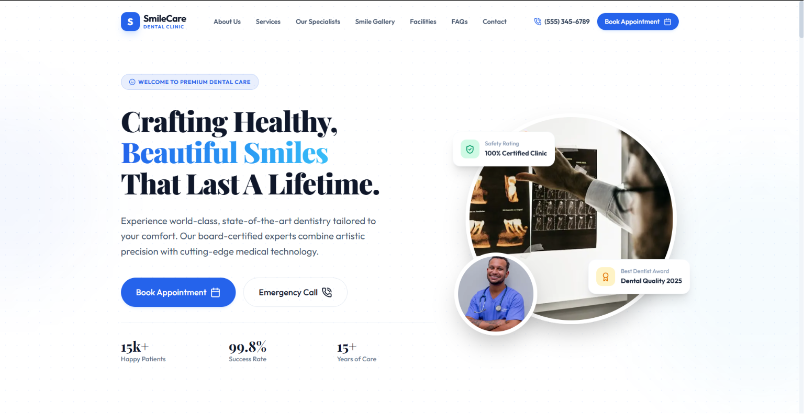 | 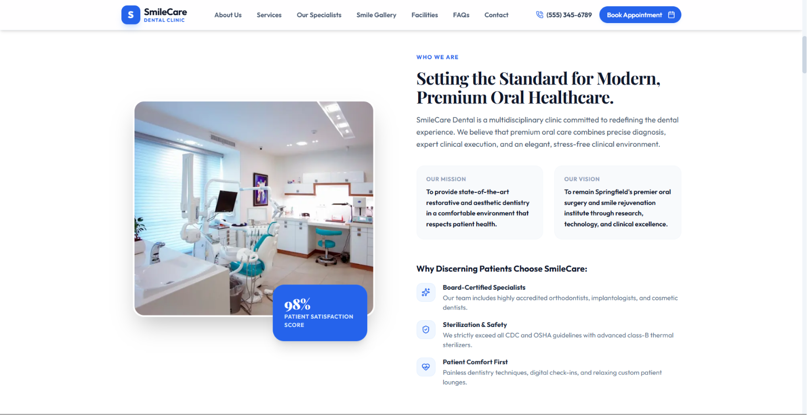 |

---

### 🦷 Services & Our Specialists

| Services | Our Specialists |
|----------|-----------------|
| 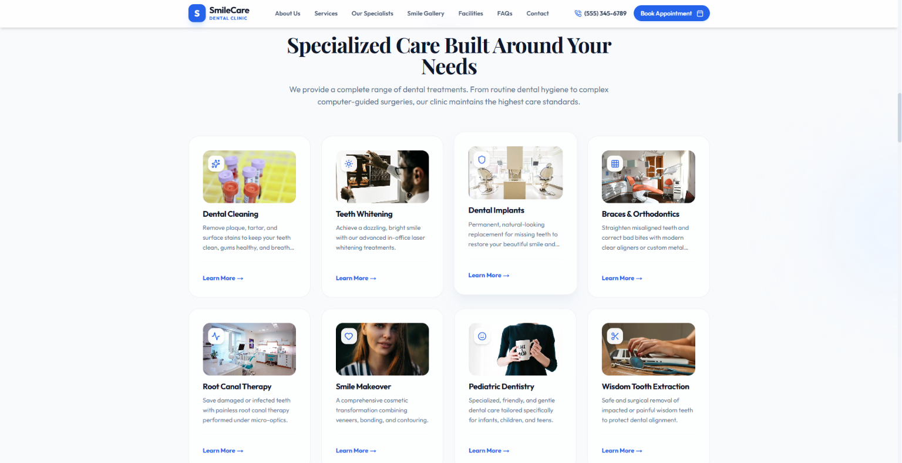 | 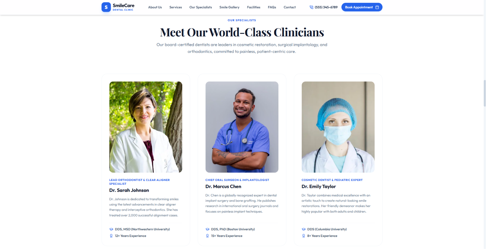 |

---

### ✨ Smile Gallery & Testimonials

| Smile Gallery | Testimonials |
|---------------|--------------|
| 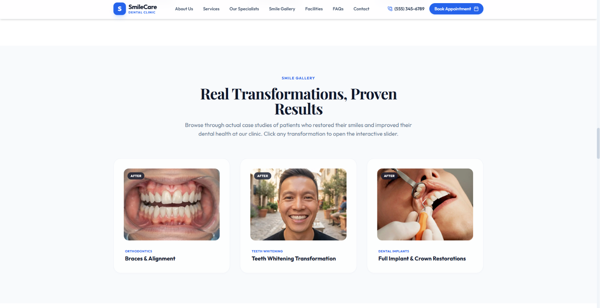 | 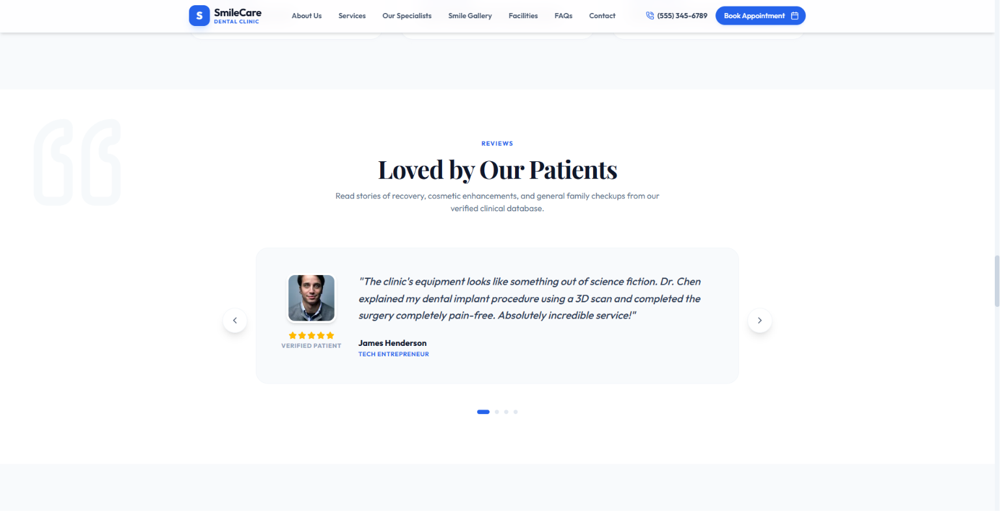 |

---

### 📅 Appointment & Facilities

| Book Appointment | Facilities |
|------------------|------------|
| 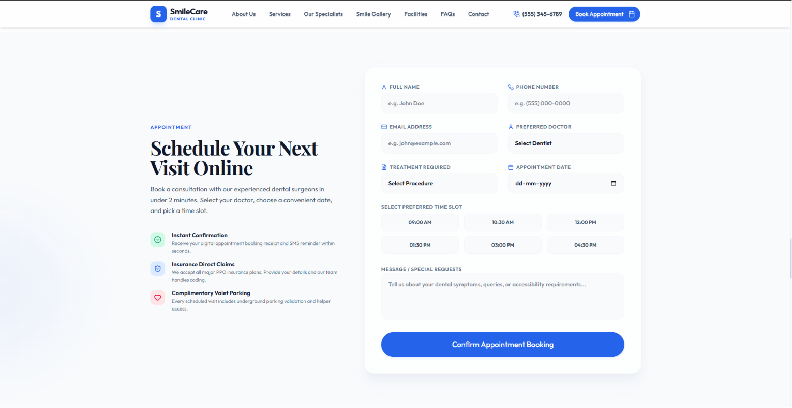 | 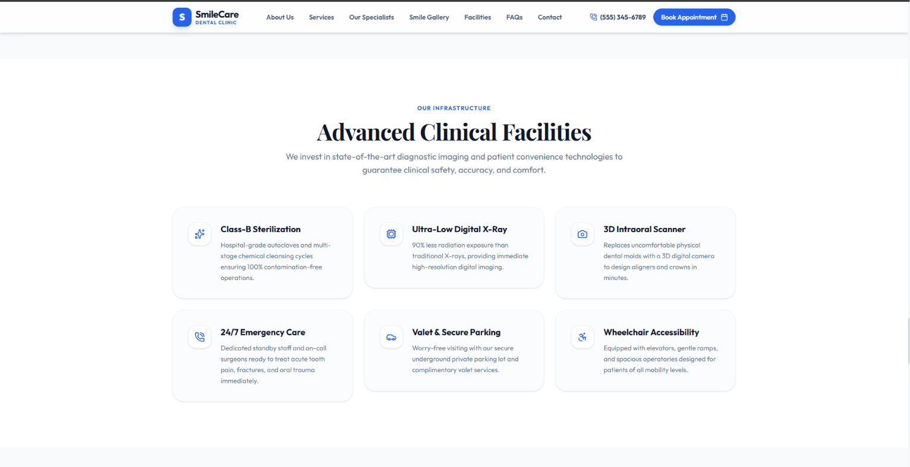 |

---

### ❓ FAQ & Contact

| FAQ | Contact |
|-----|---------|
| 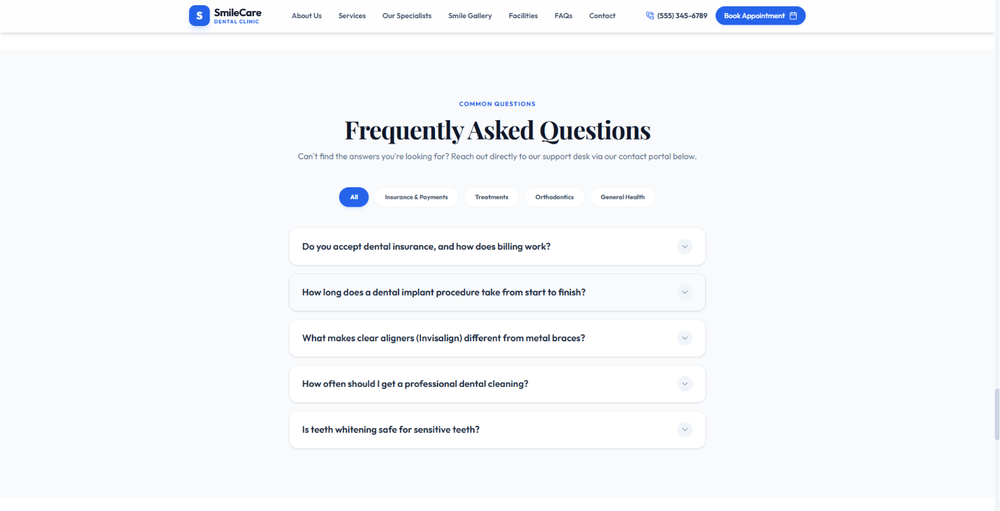 | 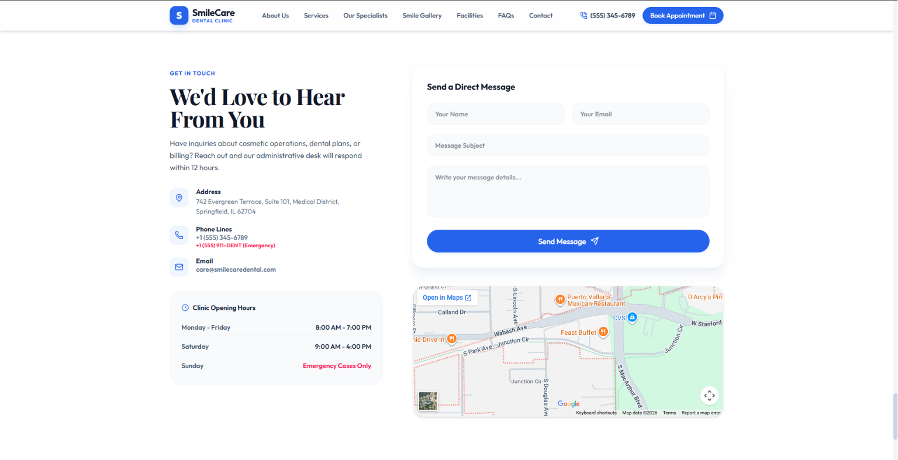 |

---

### 📱 Mobile Preview

<p align="center">
  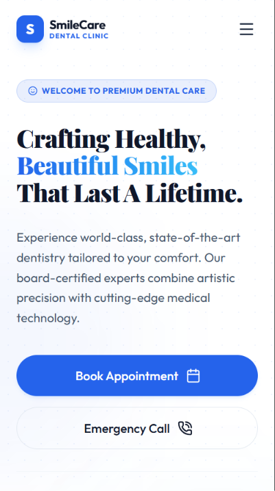
</p>

---

# 📂 Project Structure

```text
everglow-dental/
│
├── public/
│   ├── favicon.ico
│   ├── images/
│   └── icons/
│
├── screenshots/
│   ├── 01-home.png
│   ├── 02-about.png
│   ├── 03-services.png
│   ├── 04-our-specialists.png
│   ├── 05-smile-gallery.png
│   ├── 06-testimonials.png
│   ├── 07-book-appointment.png
│   ├── 08-facilities.png
│   ├── 09-faqs.png
│   ├── 10-contact.png
│   └── 11-mobile-preview.png
│
├── src/
│   ├── app/
│   │   ├── globals.css          # Design system & CSS tokens
│   │   ├── layout.tsx           # SEO metadata, font definitions, and root layout
│   │   └── page.tsx             # Main landing page combining all sections
│   │
│   ├── components/
│   │   ├── sections/
│   │   │   ├── About.tsx        # Clinic story, mission, and core values
│   │   │   ├── BeforeAfterGallery.tsx # Interactive before/after transformation slider
│   │   │   ├── Booking.tsx      # Multi-field booking form with confetti & validation
│   │   │   ├── Contact.tsx      # Contact details, alternative phone/email, map & form
│   │   │   ├── Dentists.tsx     # Board-certified specialist team cards
│   │   │   ├── FAQ.tsx          # Categorized expandable question accordions
│   │   │   ├── Facilities.tsx   # Technology and clinical sterilization features
│   │   │   ├── Footer.tsx       # Branding, hours, alternative contacts, and newsletter
│   │   │   ├── Hero.tsx         # Hero section with primary & emergency call CTAs
│   │   │   ├── Navbar.tsx       # Sticky responsive navigation with mobile drawer
│   │   │   ├── Services.tsx     # Service cards and detailed modal viewer
│   │   │   └── Testimonials.tsx # Patient reviews and ratings carousel
│   │   │
│   │   └── ui/
│   │       ├── BeforeAfterSlider.tsx # Comparison slider component
│   │       ├── Button.tsx       # Reusable button with variants
│   │       ├── Card.tsx         # Card wrapper component
│   │       ├── Modal.tsx        # Accessible dialog component
│   │       └── Toast.tsx        # Dismissible notification toast
│   │
│   └── data/
│       └── dentalData.ts        # Services, dentists, FAQs, contact info & reviews data
│
├── package.json
├── tsconfig.json
├── postcss.config.mjs
└── README.md
```

---

# ⚙️ Getting Started

### 1. Clone the repository

```bash
git clone https://github.com/Pulipati-Rahul/smile-care-dental.git
```

### 2. Navigate to project directory

```bash
cd EverGlow-Dental
```

### 3. Install dependencies

```bash
npm install
```

### 4. Run the development server

```bash
npm run dev
```

Open [http://localhost:3000](http://localhost:3000) in your browser to view the application.

---

# 🏗️ Build for Production

To create an optimized production build:

```bash
npm run build
npm run start
```

---

# 🚀 Future Roadmap

- [ ] Online Patient Portal for electronic dental health records (EDHR)
- [ ] Direct insurance eligibility pre-verification tool
- [ ] Integrated payment gateway for prepayment and deposits (Stripe)
- [ ] SMS / WhatsApp appointment confirmation reminders
- [ ] Live AI dental triage assistant for preliminary symptom evaluation
- [ ] Multi-lingual support (English, Spanish)

---

# 👨‍💻 Author

**Pulipati Rahul**

- **GitHub:** [https://github.com/Pulipati-Rahul](https://github.com/Pulipati-Rahul)
- **LinkedIn:** [https://www.linkedin.com/in/pulipatirahul](https://www.linkedin.com/in/pulipatirahul)
- **Portfolio:** [https://pulipatirahul.vercel.app](https://pulipatirahul.vercel.app)

---

# ⭐ Support

If you found this project helpful, consider starring ⭐ the repository on GitHub!
